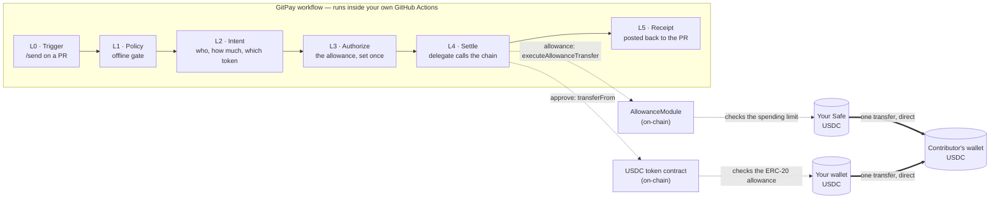
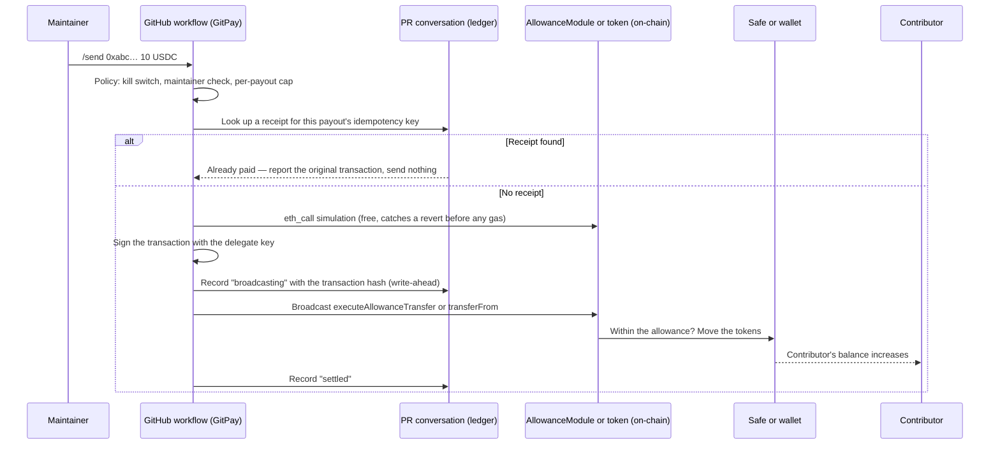

# GitPay Settlement Flow

How a payout actually moves. Tokens go once, on-chain, straight from your Safe or your wallet to
the contributor. GitPay's code is never a party to that transfer and never holds the funds.

There are two settlement schemes, and this file describes both:

- **`allowance`** (default) pays from a **Safe** through the Safe AllowanceModule (see
  [DECISION-LOG.md](DECISION-LOG.md) §4).
- **`approve`** pays from an **ordinary wallet** — MetaMask, Rabby, a hardware wallet — through a
  plain ERC-20 allowance, for adopters who have no Safe (§13).

The earlier design, where a maintainer signed each payout as an EIP-3009 authorization, is
superseded.

## The idea in one paragraph

You grant a **delegate** address a bounded allowance once, on-chain. The delegate's key is a
secret in your repository. When a maintainer types `/send` on a PR, the workflow checks policy
and has the delegate move the tokens from your funds to the contributor. Nobody signs anything
per payout. The allowance is the authorization, and the chain enforces it.

The two schemes differ only in where the funds sit and how the allowance is set:

| | `allowance` — from a Safe | `approve` — from a wallet |
|---|---|---|
| Funds sit in | your Safe | your ordinary wallet (the `payer`) |
| You grant | a spending limit in Safe{Wallet} | `approve(delegate, N)` on the token |
| The delegate calls | `executeAllowanceTransfer` on the AllowanceModule | `transferFrom(payer, recipient, amount)` on the token |
| The bound | N per period, resets automatically | N in total, does not reset — top it up by hand |
| Revoke | delete the spending limit | `approve(delegate, 0)` |

## One-time setup

### `allowance` — from a Safe

1. **Spending limit.** In Safe{Wallet}, go to Settings → Setup → Spending limits → New spending
   limit. Pick the delegate address, the token (testnet USDC), an amount, and a reset period.
   The first use deploys and enables the module. On Ethereum Sepolia the module is canonically
   deployed at `0xCFbFaC74C26F8647cBDb8c5caf80BB5b32E43134`.
2. **Delegate gas.** The delegate is an ordinary account and pays gas for each payout, so give
   it some Sepolia ETH.
3. **Workflow inputs.** Set `mode: self`, then `safe`, `token`, `rpc_url`, and `delegate_key`
   (a repository secret). Also set `pr` and `github_token`, because receipts are written to the
   PR. `chain_id`, `allowance_module` and `explorer_url` come from the chain registry and need
   no input unless you override them.

### `approve` — from an ordinary wallet

1. **Approve the delegate.** From the wallet holding the funds, call `approve(delegate, N)` on
   the token contract. Etherscan's *Write as Proxy* tab works. N is the most the delegate may
   ever spend until you approve again.
2. **Delegate gas.** As above: give the delegate some Sepolia ETH.
3. **Workflow inputs.** Set `mode: self` and `scheme: approve`, then `payer` (the wallet that
   approved), `token`, `rpc_url`, and `delegate_key`, plus `pr` and `github_token`.

The delegate must be a **separate** address from the payer. The driver refuses a delegate key
that controls the payer itself, because that would put the payout wallet's own key in CI, with
no bound at all.

Without `mode: self`, every run is a dry run (I5). It resolves the payout and reports what would
happen, and moves nothing.

## Overview: pipeline vs. money

No box in the `GP` pipeline ever holds the token. The transfer is a bold arrow, from your Safe or
your wallet to the contributor. A given workflow uses one scheme; both are shown here.

## Zoom in: `/send` → contributor's wallet

## Why this is safe, and what it trusts

**The on-chain allowance is the ceiling.** The delegate can move no more than you granted, and
only the token you picked. The chain enforces that, not GitPay.

- Under **`allowance`**, a leaked or misused delegate key can spend the allowance **every
  period** until the owners remove the spending limit, and nothing else in the Safe. Losses
  add up across resets. Keep the limit sized to what you would pay out in one period, and
  remove it if the key is ever exposed.
- Under **`approve`**, the key can spend **what is left** of the ERC-20 allowance, once. It does
  not refill. Approve only what you plan to pay out soon, and revoke with
  `approve(delegate, 0)` if the key is ever exposed.

**The delegate key is the trust boundary.** Whoever can read the `delegate_key` secret, or edit
the workflow that uses it, can spend the allowance. That is why policy runs first: `/send` is
honoured only from an author association in `allowed_associations`, and `max_per_payout` caps a
single payout (I10). The kill switch `enabled: false` stops everything.

**Exactly-once comes from the ledger, not the chain.** Neither rail refuses an identical second
call: the AllowanceModule never checks its nonce on the delegate path, and `transferFrom` has no
nonce at all. While the allowance has headroom, either would transfer again. So every payout has
a deterministic idempotency key (repo, ref, recipient, network, asset, round; never the amount,
never the scheme), and a receipt comment on the PR records it **before** the broadcast. A re-run
finds the receipt and pays nothing again (I8, I9). Switching a repo from `allowance` to
`approve` does not re-pay anything either. What a re-run reports depends on the receipt:

- `settled`: the transaction confirmed. The run reports `already-paid` and passes.
- `broadcasting`: the receipt was written before the broadcast and never confirmed, so the
  outcome is unknown. The run reports `unconfirmed` and **fails**. Check the hash on the
  explorer. If it succeeded, the contributor is paid. If it is still pending, wait. Only if it
  failed (reverted) or was dropped, re-pay. A reverted transaction is in a block too, so
  "landed" is not the test: only success means paid.

Paying the same person again on the same PR is a deliberate act: add `round:1` to the `/send`
(`/send 0xabc 10 round:1`), or bump the `round` input.

**Serialize payouts.** A ledger lookup is check-then-act, so two runs at once could both miss.
Put payouts in a `concurrency:` group keyed on the PR.

## Layers, in plain terms

| Layer | What it does |
|---|---|
| L0 Trigger | A maintainer's `/send` on a PR, or workflow inputs, becomes an Intent. |
| L1 Policy | Offline checks before anything touches a chain: kill switch, who may send, per-payout cap. |
| L2 Intent | A plain description of what's owed: recipient, amount, token, network, round. |
| L3 Authorize | The allowance, set once: a Safe spending limit, or an ERC-20 `approve`. No per-payout signature. |
| L4 Settle | Simulate, record the attempt, then the delegate calls the AllowanceModule or the token. |
| L5 Receipt | A comment on the PR, which is both the human-readable receipt and the ledger entry. |

## Enforced invariants (per AGENTS.md)

- **I2** — GitPay never holds, pools, or routes funds. Tokens go from your Safe or wallet to the
  contributor.
- **I5** — the default mode is dry-run. Real settlement needs `mode: self`.
- **I8** — a repeated payout reports success and sends nothing.
- **I9** — neither rail has native replay protection, so settlement refuses to run without a
  ledger.
- **I10** — no amount above `max_per_payout` reaches the driver.
